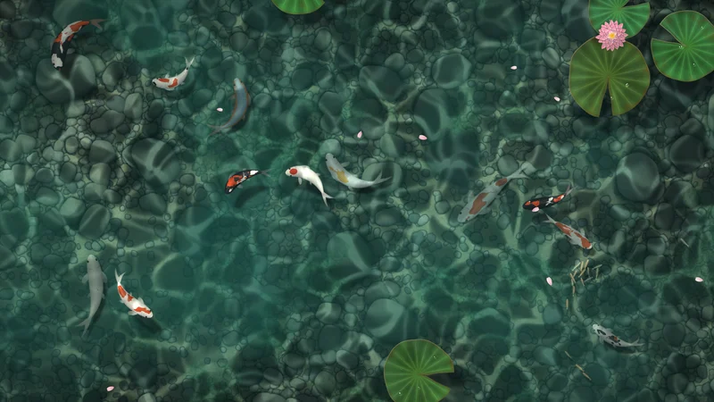

# Plasma Living Wallpapers

Live, interactive wallpapers for KDE Plasma 6. Each one is a small world on your desktop
that reacts to the cursor and clicks. They are native QML and GPU shaders, with no browser
engine, and pause while a window covers the screen.



| Wallpaper | What it is |
|---|---|
| [Koi Pond](wallpapers/koipond) | Koi, minnows, lily pads and ripples. Feed them, stir the water, startle them. One pond can span all your monitors. |

More are on the way.

## Install

Needs Plasma 6 and `qsb` from Qt Shader Tools (`qt6-shadertools` on Arch, `qt6-shader-baker`
on Debian/Ubuntu).

```sh
git clone https://github.com/mzrokz/plasma-living-wallpapers
cd plasma-living-wallpapers
./install.sh            # all of them
./install.sh koipond    # or just one
```

Then right-click the desktop, choose **Desktop and Wallpaper**, and pick the wallpaper type.
After upgrading one that is already in use, restart the shell to load the new version:
`systemctl --user restart plasma-plasmashell`.

## Layout

Each wallpaper in `wallpapers/<name>` is a self-contained Plasma package with its own
`build.sh`, `install.sh`, shaders and README.

## Credits

Koi Pond was inspired by two browser koi ponds:

- [nagomi](https://github.com/msk1039/nagomi) by [Mayank Kadam](https://github.com/msk1039)
  ([live demo](https://nagomi-blue.vercel.app/))
- [interactive-koi-pond](https://github.com/rzrabbi/interactive-koi-pond) by
  [Rezaye Rabbi](https://github.com/rzrabbi)
  ([live demo](https://rzrabbi.github.io/interactive-koi-pond/demo/))

No code was taken from either; this is an independent implementation for Plasma.

## License

MIT
